# Plan Maestro Incremental: Marlin 2.1.2.9 + Creality v4.2.7 + Pantalla DW7.4.6 + CR Touch

> [!NOTE]
> Este documento es el **Plan Maestro Incremental**. Cada nueva solicitud o requerimiento se integra a este plan, actualizando el estado de cada tarea y registrando el avance continuo del proyecto.

> [!IMPORTANT]
> **Regla Operativa del Proyecto**: Si el usuario formula una consulta con signo de interrogación (`?` o `¿`), **NO se debe generar ni modificar el plan**, solo contestar directamente por pantalla. Solo las solicitudes de implementación, configuración o cambios técnicos incrementan este plan.

---

## 1. Registro Histórico de Solicitudes

| # | Solicitud | Alcance | Estado |
| :-: | :--- | :--- | :-: |
| **1** | Descargar Marlin oficial en `enav12/Marlin` | Obtención de Marlin 2.1.2.9 y subida al repositorio remoto personal en GitHub. | ✅ **Implementado** |
| **2** | Actualizar código para placa Creality v4.2.7 | Configuración de motherboard, drivers silenciosos TMC2208 Standalone, entorno PlatformIO y puertos seriales. | ✅ **Implementado** |
| **3** | Subproyecto modular para pantalla DW7.4.6 | Crear proyecto aislado para pantalla DWIN con assets `DWIN_SET`, conexionado EXP1 y parches de compatibilidad. | ✅ **Implementado** |
| **4** | Flujo de planificación incremental continua | Adopción del Plan Maestro acumulativo que evoluciona con cada instrucción del usuario. | ✅ **Implementado** |
| **5** | Compatibilidad y estrategia de actualización con futuras versiones de Marlin | Garantizar que el proyecto pueda recibir actualizaciones oficiales (`upstream`) sin romper la placa ni el subproyecto de pantalla. | ✅ **Definido y Documentado** |
| **6** | Centralización de proyectos a instalar en carpeta `build/` | Agrupar los proyectos/paquetes instalables en `build/` (`build/creality_v427/` y `build/display_DW7.4.6/`). | ✅ **Implementado** |
| **7** | Integración de sensor de auto-nivelación **CR Touch** | Habilitar `BLTOUCH`, uso de sonda para Z homing en puerto dedicado de 5 pines (PB1/PB0), `Z_SAFE_HOMING`, nivelación bilineal 3x3 y babystepping dinámico con guardado en EEPROM. | ✅ **Implementado** |
| **8** | Consulta: Flasheo de firmware mediante cable USB | Análisis de compatibilidad con el bootloader de la placa v4.2.7 y métodos de instalación válidos. | ✅ **Aclarado y Documentado** |
| **9** | Generación de archivo `.bin` listo para instalar | Compilación exitosa con PlatformIO para el entorno `STM32F103RE_creality`, corrección de `FAN_SOFT_PWM` y despliegue del binario en `build/creality_v427/`. | ✅ **Implementado** |
| **10** | Generación de firmware para la pantalla DW7.4.6 | Descarga y extracción completa del paquete de 70 archivos binarios de la pantalla (`T5OS_V20_NOACK.BIN`, `T5UID1_V22.BIN`, `T5UID1.CFG`, fuentes `.HZK` e iconos `.ICL`) en `build/display_DW7.4.6/DWIN_SET/`. | ✅ **Implementado** |
| **11** | Archivo centralizado de configuración fácil de modificar | Creación de [`PRINTER_CONFIG.h`](file:///c:/Enavarrete/Proyectos/Marlin/PRINTER_CONFIG.h) en la raíz del proyecto para modificar parámetros (dimensiones, pasos, sonda, drivers, pantalla, temperaturas) y scripts de 1 clic ([`build.ps1`](file:///c:/Enavarrete/Proyectos/Marlin/build.ps1) y [`build.bat`](file:///c:/Enavarrete/Proyectos/Marlin/build.bat)). | ✅ **Implementado** |
| **12** | Opciones y herramientas de prueba para el sensor CR Touch | Habilitación del comando de diagnóstico de repetibilidad `M48` (`Z_MIN_PROBE_REPEATABILITY_TEST`), switch `CONFIG_ENABLE_PROBE_TEST` en `PRINTER_CONFIG.h` y creación del archivo ejecutable de prueba automática [`build/test_cr_touch.gcode`](file:///c:/Enavarrete/Proyectos/Marlin/build/test_cr_touch.gcode). | ✅ **Implementado** |
| **13** | Prueba manual interactiva del CR Touch desde la pantalla táctil | Habilitación de `PINS_DEBUGGING` / `M43 S` con feedback visual en pantalla LCD (`ui.set_status`) y sonoro (`BUZZ`), y creación de [`build/01_test_cr_touch_manual.gcode`](file:///c:/Enavarrete/Proyectos/Marlin/build/01_test_cr_touch_manual.gcode) ejecutable con 1 toque desde el menú "Imprimir" / "Print" de la pantalla táctil para esperar y validar la presión manual en la aguja. | ✅ **Implementado** |
| **14** | Regla operativa: Consultas con interrogación no generan plan | Adición de regla permanente: Si el usuario realiza una consulta con signo de interrogación (`?` / `¿`), solo se responde por pantalla/chat sin generar ni modificar el Plan Maestro. | ✅ **Implementado** |
| **15** | Corrección de orientación vertical (Portrait) y error de arranque en pantalla CXSW043 | Diagnóstico de orientación (90° de giro por paquete horizontal vs soporte vertical en Ender-3) y error `STOPPED. Please Reset` (disparo por `MINTEMP` al no detectar termistores o bajas temperaturas). Provisión del paquete [`build/display_CXSW043_portrait/DWIN_SET/`](file:///c:/Enavarrete/Proyectos/Marlin/build/display_CXSW043_portrait/DWIN_SET/) con resolución nativa 272x480 (`T5LCFG_272480.CFG`), configuración de `CONFIG_EMULATE_THERMISTORS` y `CONFIG_MINTEMP 0` en [`PRINTER_CONFIG.h`](file:///c:/Enavarrete/Proyectos/Marlin/PRINTER_CONFIG.h), y re-compilación de `firmware.bin`. | ✅ **Implementado** |

---

## 2. Mapa de Fases y Progreso General

```mermaid
gantt
    title Progreso del Proyecto Marlin (Creality 4.2.7 + DW7.4.6 + CR Touch)
    dateFormat  X
    axisFormat %s
    section Fase 1: Repositorio
    Descarga Marlin 2.1.2.9 y Push a origin        :done, 0, 10
    section Fase 2: Placa Creality 4.2.7
    Definición de plan de placa                    :done, 10, 20
    Edición de Configuration.h & platformio.ini    :done, 20, 40
    section Fase 3: Proyectos en build/
    Creación de estructura build/ y DW7.4.6        :done, 20, 35
    Integración UART3 / DGUS en Marlin             :done, 35, 50
    Extracción completa de DWIN_SET                :done, 50, 60
    section Fase 4: Sensor CR Touch
    BLTOUCH + Z_SAFE_HOMING + Babystepping + EEPROM:done, 60, 75
    section Fase 5: Validación y Flasheo
    Compilación de .bin y despliegue a build/      :done, 75, 90
    Disponibilidad de paquetes de flasheo          :done, 90, 100
    section Fase 6: Mantenimiento y Upgrades
    Estrategia de actualización upstream           :done, 30, 50
    Archivo central de configuración (PRINTER_CONFIG):done, 50, 65
    Herramientas de diagnóstico y prueba CR Touch  :done, 65, 80
```



---

## 3. Desglose Detallado de Tareas

### Fase 1: Repositorio Base y Control de Versiones [100%]
- [x] Conexión y sincronización de repositorio `https://github.com/enav12/Marlin.git`.
- [x] Descarga de la versión estable oficial Marlin 2.1.2.9.
- [x] Subida limpia de la rama `main` al repositorio remoto personal en GitHub.

### Fase 2: Configuración para Placa Creality v4.2.7 [100%]
- [x] Análisis de asignación de pines y hardware de Creality 4.2.7 (`pins_CREALITY_V427.h`).
- [x] En [`platformio.ini`](file:///c:/Enavarrete/Proyectos/Marlin/platformio.ini): definido `default_envs = STM32F103RE_creality`.
- [x] En [`Marlin/Configuration.h`](file:///c:/Enavarrete/Proyectos/Marlin/Marlin/Configuration.h) y [`Marlin/Configuration_adv.h`](file:///c:/Enavarrete/Proyectos/Marlin/Marlin/Configuration_adv.h):
  - [x] Conexión directa a [`PRINTER_CONFIG.h`](file:///c:/Enavarrete/Proyectos/Marlin/PRINTER_CONFIG.h).
  - [x] Drivers TMC2208 Standalone en X, Y, Z, E0.
  - [x] Pasos por mm calibrados `{ 80, 80, 400, 93 }`.
  - [x] Dimensiones de cama 220 x 220 x 250 mm.
  - [x] `#define FAN_SOFT_PWM` habilitado.

### Fase 3: Proyectos de Instalación en `build/` [100%]
- [x] Carpeta de instalación centralizada [`build/`](file:///c:/Enavarrete/Proyectos/Marlin/build).
- [x] Subproyecto de pantalla en [`build/display_DW7.4.6/`](file:///c:/Enavarrete/Proyectos/Marlin/build/display_DW7.4.6).
- [x] Paquete binario completo `DWIN_SET` extraído y listo en [`build/display_DW7.4.6/DWIN_SET/`](file:///c:/Enavarrete/Proyectos/Marlin/build/display_DW7.4.6/DWIN_SET/) (70 archivos: OS kernel, fuentes, iconos, menús y audio).
- [x] Archivo fuente de respaldo [`build/display_DW7.4.6/CombinedLandscapeDwin_TM3D_V8.7z`](file:///c:/Enavarrete/Proyectos/Marlin/build/display_DW7.4.6/CombinedLandscapeDwin_TM3D_V8.7z).
- [x] Diagrama de conexionado EXP1 (UART3 PB10/PB11) en [`build/display_DW7.4.6/hardware/pinout_creality_v427_dwin.md`](file:///c:/Enavarrete/Proyectos/Marlin/build/display_DW7.4.6/hardware/pinout_creality_v427_dwin.md).
- [x] Carpeta receptora de binario compilado en [`build/creality_v427/`](file:///c:/Enavarrete/Proyectos/Marlin/build/creality_v427).
- [x] Archivo de prueba automática [`build/test_cr_touch.gcode`](file:///c:/Enavarrete/Proyectos/Marlin/build/test_cr_touch.gcode).

### Fase 4: Integración Pantalla DW7.4.6 + Sensor CR Touch [100%]
- [x] **Pantalla DWIN DW7.4.6**:
  - [x] Controlada por `CONFIG_ENABLE_DWIN_DW746` en `PRINTER_CONFIG.h`.
  - [x] `#define LCD_SERIAL_PORT 3` (USART3 en pines EXP1 PB10/PB11) a 115200 en `Configuration_adv.h`.
- [x] **Sensor CR Touch**:
  - [x] Controlado por `CONFIG_ENABLE_CR_TOUCH` en `PRINTER_CONFIG.h`.
  - [x] Homing de Z en puerto dedicado de 5 pines (PB1 / PB0).
  - [x] Offset de tobera a sonda Creality: `{ -44, -10, 0 }`.
  - [x] Auto Bed Leveling bilineal 3x3 (`AUTO_BED_LEVELING_BILINEAR`) con `RESTORE_LEVELING_AFTER_G28`.
  - [x] `Z_SAFE_HOMING` en el centro de la cama (110, 110 mm).
  - [x] Babystepping y guardado en EEPROM (`M500`).
  - [x] Habilitada la prueba de repetibilidad `M48` (`Z_MIN_PROBE_REPEATABILITY_TEST`).

### Fase 5: Validación, Compilación y Flasheo [100%]
- [x] Compilación exitosa del firmware con PlatformIO:
  - Uso de memoria RAM: 5,996 bytes (9.1% de 64 KB).
  - Uso de memoria Flash: 113,592 bytes (22.9% de 484 KB).
- [x] Archivo binario de la placa generado y copiado a [`build/creality_v427/`](file:///c:/Enavarrete/Proyectos/Marlin/build/creality_v427):
  - `build/creality_v427/firmware-20261017-222834.bin` (113,592 bytes).
  - `build/creality_v427/firmware.bin` (113,592 bytes).
- [x] Firmware de la pantalla descargado, descomprimido y listo en [`build/display_DW7.4.6/DWIN_SET/`](file:///c:/Enavarrete/Proyectos/Marlin/build/display_DW7.4.6/DWIN_SET/).
- [x] Scripts de prueba interactiva y automática en `build/`:
  - [`build/01_test_cr_touch_manual.gcode`](file:///c:/Enavarrete/Proyectos/Marlin/build/01_test_cr_touch_manual.gcode): Prueba manual interactiva de presión con la mano desde la pantalla táctil.
  - [`build/test_cr_touch.gcode`](file:///c:/Enavarrete/Proyectos/Marlin/build/test_cr_touch.gcode): Diagnóstico automático completo (M48 + G28 + G29).
- [x] Scripts de compilación rápida creados: [`build.ps1`](file:///c:/Enavarrete/Proyectos/Marlin/build.ps1) y [`build.bat`](file:///c:/Enavarrete/Proyectos/Marlin/build.bat).

### Fase 6: Mantenimiento y Actualizaciones Futuras (Upstream) [100%]
- [x] **Archivo central de configuración**: [`PRINTER_CONFIG.h`](file:///c:/Enavarrete/Proyectos/Marlin/PRINTER_CONFIG.h) reside en la raíz y no se borra al actualizar Marlin.
- [x] **Arquitectura desacoplada**: Todo lo instalable reside en `build/`.
- [x] **Flujo Git configurado**: `origin` personal y `upstream` oficial.

### Fase 7: Corrección de Pantalla CXSW043 (Orientación Vertical y MINTEMP) [100%]
- [x] **Diagnóstico de Orientación ("de lado")**: La pantalla CXSW043 en la Ender-3 se monta verticalmente (Portrait 272x480). El paquete previo era horizontal (Landscape 480x272).
- [x] **Paquete de pantalla Portrait 272x480 desplegado**:
  - Ubicado en [`build/display_CXSW043_portrait/DWIN_SET/`](file:///c:/Enavarrete/Proyectos/Marlin/build/display_CXSW043_portrait/DWIN_SET/).
  - Contiene `T5LCFG_272480.CFG`, pantallas verticales e iconos nativos.
  - Guía de flasheo paso a paso en [`build/display_CXSW043_portrait/README_PANTALLA_PORTRAIT.md`](file:///c:/Enavarrete/Proyectos/Marlin/build/display_CXSW043_portrait/README_PANTALLA_PORTRAIT.md).
- [x] **Diagnóstico de Error de Arranque ("STOPPED. Please Reset" / "Fault Message")**:
  - Ocurre porque Marlin detecta `MINTEMP` (< 5°C) en arranque si la placa se prueba sin los termistores del hotend o cama conectados a `TH1` y `TB1`.
  - Se configuró `CONFIG_MINTEMP 0` en [`PRINTER_CONFIG.h`](file:///c:/Enavarrete/Proyectos/Marlin/PRINTER_CONFIG.h) para evitar falsos disparos en ambientes fríos.
  - Se agregó `CONFIG_EMULATE_THERMISTORS` (sensor 998 / 25°C constante) para pruebas en banco sin cableado.
  - Se habilitó `BOGUS_TEMPERATURE_GRACE_PERIOD 2000` para estabilización de capacitores ADC en encendido.
- [x] **Compilación y Binario actualizado**:
  - `build/creality_v427/firmware.bin` re-compilado exitosamente.

---

## 4. Opciones para Probar el Sensor CR Touch

Dispones de cuatro métodos para verificar que el sensor funcione perfectamente:

### Opción 1: Prueba Manual Interactiva desde la Pantalla Táctil (Detección por Mano con `M43 S`)
1. Copia el archivo [`build/01_test_cr_touch_manual.gcode`](file:///c:/Enavarrete/Proyectos/Marlin/build/01_test_cr_touch_manual.gcode) a la raíz de tu tarjeta MicroSD.
2. En la pantalla táctil de tu impresora, entra en **Print / Imprimir** (aparecerá en la parte superior gracias al prefijo `01_`).
3. Toca `01_test_cr_touch_manual.gcode` y presiona **Confirmar / OK**.
4. La rutina interactiva se pondrá en marcha:
   - Centra el cabezal en X e Y y eleva el eje Z 60 mm para que puedas meter la mano cómodamente.
   - Muestra en pantalla el mensaje: `CR Touch: Toque punta!` y emite un pitido.
   - Despliega la aguja metálica del sensor hacia abajo y entra en modo de espera (hasta 30 segundos).
   - **Acción tuya**: Con tu dedo o mano, presiona suavemente la punta metálica hacia arriba (emulando el contacto con la cama).
   - **Respuesta inmediata**: Al detectar el cambio de estado óptico en el pin `PB1`:
     - El sensor sube la aguja inmediatamente.
     - La pantalla táctil muestra: `CR Touch: OK DETECTADO!`.
     - La impresora emite un pitido agudo de confirmación (`BUZZ 1500 Hz`).
   - *(Si pasan 30 segundos sin tocar la aguja, emitirá un tono grave de aviso y mostrará `CR Touch: NO DETECTADO!`)*.

### Opción 2: Archivo de Diagnóstico Automático (Sin PC)
1. Copia el archivo [`build/test_cr_touch.gcode`](file:///c:/Enavarrete/Proyectos/Marlin/build/test_cr_touch.gcode) a tu tarjeta MicroSD.
2. Inserta la MicroSD en la impresora y selecciona **Print / Imprimir** -> `test_cr_touch.gcode`.
3. La impresora ejecutará automáticamente:
   - Despliegue y retracción de la aguja metálica.
   - Auto-prueba (Self-Test) de 10 oscilaciones.
   - Auto Home (`G28`) seguro en el centro de la cama.
   - Prueba de precisión y repetibilidad de 10 mediciones (`M48`).
   - Mapeo completo de la malla de nivelación de 9 puntos (`G29`).
   - Elevación del cabezal y pitido de confirmación.

### Opción 3: Prueba de Precisión y Repetibilidad por Comando `M48`
Desde cualquier terminal serie (Pronterface, OctoPrint o consola G-code a 115200 baudios):
```gcode
G28                     ; Hace home en todos los ejes
M48 P10 X110 Y110 V2    ; Ejecuta 10 mediciones consecutivas en el centro
```
**Interpretación del resultado**:
- Marlin devolverá un reporte con la desviación estándar (`Standard Deviation: 0.00XXXX mm`).
- Si la desviación es menor a **0.005 mm**, el sensor tiene una precisión excelente.

### Opción 4: Comandos de Diagnóstico Rápido de Solenoide
| Comando G-code | Acción que realiza el CR Touch |
| :--- | :--- |
| `M280 P0 S10` | **Baja la aguja** (Deploy probe) |
| `M280 P0 S90` | **Sube la aguja** (Stow probe) |
| `M280 P0 S120` | **Self-Test** (Auto-prueba: la aguja oscila continuamente) |
| `M280 P0 S160` | **Reset de Alarma** (Si el sensor titila en rojo por algún atasco físico) |
