# Plan Maestro Incremental: Marlin 2.1.2.9 + Creality v4.2.7 + Pantalla DW7.4.6

> [!NOTE]
> Este documento es el **Plan Maestro Incremental**. Cada nueva solicitud o requerimiento se integrará a este plan, actualizando el estado de cada tarea y registrando el avance hasta la implementación final.

---

## 1. Registro Histórico de Solicitudes

| # | Solicitud | Alcance | Estado |
| :-: | :--- | :--- | :-: |
| **1** | Descargar Marlin oficial en `enav12/Marlin` | Obtención de Marlin 2.1.2.9 y subida al repositorio remoto personal en GitHub. | ✅ **Implementado** |
| **2** | Actualizar código para placa Creality v4.2.7 | Configuración de motherboard, drivers silenciosos TMC2208 Standalone, entorno PlatformIO y puertos seriales. | ⏳ **Planificado** |
| **3** | Subproyecto modular para pantalla DW7.4.6 | Crear proyecto aislado para pantalla DWIN con assets `DWIN_SET`, conexionado EXP1 y parches de compatibilidad. | 🟡 **Parcialmente Implementado** (Estructura lista, pendiente integración activa) |
| **4** | Flujo de planificación incremental continua | Adopción del Plan Maestro acumulativo que evoluciona con cada instrucción del usuario. | ✅ **Implementado** |
| **5** | Compatibilidad y estrategia de actualización con futuras versiones de Marlin | Garantizar que el proyecto pueda recibir actualizaciones oficiales (`upstream`) sin romper la placa ni el subproyecto de pantalla. | ✅ **Definido y Documentado** |

---

## 2. Mapa de Fases y Progreso General

```mermaid
gantt
    title Progreso del Proyecto Marlin (Creality 4.2.7 + DW7.4.6)
    dateFormat  X
    axisFormat %s
    section Fase 1: Repositorio
    Descarga Marlin 2.1.2.9 y Push a origin        :done, 0, 10
    section Fase 2: Placa Creality 4.2.7
    Definición de plan de placa                    :done, 10, 20
    Edición de Configuration.h & platformio.ini    :active, 20, 40
    section Fase 3: Pantalla DW7.4.6
    Creación de estructura modular display_DW7.4.6 :done, 20, 30
    Integración UART3 / DGUS en Marlin             :crit, 40, 60
    section Fase 4: Validación y Flasheo
    Prueba de compilación PlatformIO               :60, 80
    Generación de binarios para MicroSD            :80, 100
    section Fase 5: Mantenimiento y Upgrades
    Estrategia de actualización upstream           :done, 30, 50
```



---

## 3. Desglose Detallado de Tareas

### Fase 1: Repositorio Base y Control de Versiones [100%]
- [x] Conexión y sincronización de repositorio `https://github.com/enav12/Marlin.git`.
- [x] Descarga de la versión estable oficial Marlin 2.1.2.9.
- [x] Subida limpia de la rama `main` al repositorio remoto personal en GitHub.

### Fase 2: Configuración para Placa Creality v4.2.7 [40%]
- [x] Análisis de asignación de pines y hardware de Creality 4.2.7 (`pins_CREALITY_V427.h`).
- [x] Diseño del plan de migración técnica ([plan_creality_4_2_7.md](file:///C:/Users/eduar/.gemini/antigravity-ide/brain/0e373af5-0ab1-4f4d-8c15-fe5c2153bc0e/plan_creality_4_2_7.md)).
- [ ] **Por aplicar en código**:
  - [ ] En [`platformio.ini`](file:///c:/Enavarrete/Proyectos/Marlin/platformio.ini): definir `default_envs = STM32F103RE_creality`.
  - [ ] En [`Marlin/Configuration.h`](file:///c:/Enavarrete/Proyectos/Marlin/Marlin/Configuration.h):
    - [ ] `#define MOTHERBOARD BOARD_CREALITY_V427`
    - [ ] `#define SERIAL_PORT 1` (USB CH340)
    - [ ] `#define BAUDRATE 115200`
    - [ ] Drivers TMC2208 Standalone en X, Y, Z, E0 (`TMC2208_STANDALONE`).
    - [ ] Inversión de ejes para TMC2208 (`INVERT_Z_DIR true`, etc.).
    - [ ] Dimensiones y pasos por mm del chasis.

### Fase 3: Subproyecto Pantalla DWIN DW7.4.6 [70%]
- [x] Creación de carpeta aislada [`display_DW7.4.6/`](file:///c:/Enavarrete/Proyectos/Marlin/display_DW7.4.6).
- [x] Documentación de formato de tarjeta MicroSD para pantalla (FAT32, clúster 4096 bytes) en [`display_DW7.4.6/DWIN_SET/README_DWIN_SET.md`](file:///c:/Enavarrete/Proyectos/Marlin/display_DW7.4.6/DWIN_SET/README_DWIN_SET.md).
- [x] Esquema de conexionado de pines EXP1 a DWIN UART en [`display_DW7.4.6/hardware/pinout_creality_v427_dwin.md`](file:///c:/Enavarrete/Proyectos/Marlin/display_DW7.4.6/hardware/pinout_creality_v427_dwin.md).
- [x] Parches de configuración listos en [`display_DW7.4.6/marlin_integration/Configuration_DW7.4.6_patch.h`](file:///c:/Enavarrete/Proyectos/Marlin/display_DW7.4.6/marlin_integration/Configuration_DW7.4.6_patch.h).
- [ ] Empaquetado o descarga de archivos binarios e iconos (`DWIN_SET`) finales para la pantalla.

### Fase 4: Integración Conjunta (Placa 4.2.7 + Pantalla DW7.4.6) [0%]
- [ ] Habilitar comunicación dual en Marlin:
  - `SERIAL_PORT 1` (USB a 115200)
  - `SERIAL_PORT_2 3` (USART3 en pines PB10/PB11 para el display DWIN)
- [ ] Activar controlador de pantalla en Marlin (`DGUS_LCD_UI_ORIGIN` o compatible con DW7.4.6).
- [ ] Definir `LCD_SERIAL_PORT 3` en `Configuration_adv.h`.
- [ ] Verificar que no existan conflictos de interrupciones o buffers de memoria entre ambos puertos.

### Fase 5: Validación, Compilación y Flasheo [0%]
- [ ] Compilar el firmware con PlatformIO para el entorno `STM32F103RE_creality`.
- [ ] Validar ausencia de errores y advertencias críticas.
- [ ] Generar guía final con los dos binarios:
  1. `firmware_[fecha].bin` para la placa Creality v4.2.7.
  2. Carpeta `DWIN_SET/` para la pantalla DWIN.
- [ ] Subir la versión compilada y configurada al repositorio GitHub `enav12/Marlin`.

### Fase 6: Mantenimiento y Actualizaciones Futuras (Upstream) [100%]
- [x] **Arquitectura desacoplada**: El subproyecto `display_DW7.4.6/` es inmune a cambios de Marlin porque reside en un directorio propio que no existe en el repositorio oficial.
- [x] **Flujo Git configurado**:
  - `origin`: tu repositorio personal ([enav12/Marlin](https://github.com/enav12/Marlin)).
  - `upstream`: repositorio oficial ([MarlinFirmware/Marlin](https://github.com/MarlinFirmware/Marlin)).
- [x] **Procedimiento de actualización documentado** para futuras versiones (ej. Marlin 2.1.3+ o 2.2.x).

---

## 4. Procedimiento para Actualizar Marlin en el Futuro

Cuando el equipo oficial de Marlin publique una nueva versión (ej. `2.1.3` o superior):

```bash
# 1. Obtener las últimas etiquetas y ramas oficiales
git fetch upstream

# 2. Fusionar la nueva etiqueta o rama en tu proyecto
git merge 2.1.3   # o la versión que desees incorporar

# 3. Revisar únicamente Configuration.h si Marlin agregó nuevas opciones
# (Tu carpeta display_DW7.4.6/ permanecerá intacta al 100%)

# 4. Probar compilación y subir a tu repositorio
pio run
git push origin main
```

