# Plan Maestro Incremental: Marlin 2.1.2.9 + Creality v4.2.7 + Pantalla DW7.4.6 + CR Touch

> [!NOTE]
> Este documento es el **Plan Maestro Incremental**. Cada nueva solicitud o requerimiento se integra a este plan, actualizando el estado de cada tarea y registrando el avance continuo del proyecto.

---

## 1. Registro Histórico de Solicitudes

| # | Solicitud | Alcance | Estado |
| :-: | :--- | :--- | :-: |
| **1** | Descargar Marlin oficial en `enav12/Marlin` | Obtención de Marlin 2.1.2.9 y subida al repositorio remoto personal en GitHub. | ✅ **Implementado** |
| **2** | Actualizar código para placa Creality v4.2.7 | Configuración de motherboard, drivers silenciosos TMC2208 Standalone, entorno PlatformIO y puertos seriales. | ✅ **Implementado** |
| **3** | Subproyecto modular para pantalla DW7.4.6 | Crear proyecto aislado para pantalla DWIN con assets `DWIN_SET`, conexionado EXP1 y parches de compatibilidad. | ✅ **Implementado** |
| **4** | Flujo de planificación incremental continua | Adopción del Plan Maestro acumulativo que evoluciona con cada instrucción del usuario. | ✅ **Implementado** |
| **5** | Compatibilidad y estrategia de actualización con futuras versiones de Marlin | Garantizar que el proyecto pueda recibir actualizaciones oficiales (`upstream`) sin romper la placa ni el subproyecto de pantalla. | ✅ **Definido y Documentado** |
| **6** | Centralización de proyectos a instalar en carpeta `build/` | Agrupar los proyectos/paquetes instalables en `build/` (`build/creality_v427/` y `build/display_DW7.4.6/`). | ✅ **Implementado** |
| **7** | Integración de sensor de auto-nivelación **CR Touch** | Habilitar `BLTOUCH`, uso de sonda para Z homing en puerto dedicado de 5 pines (PB1/PB0), `Z_SAFE_HOMING`, nivelación bilineal 3x3 y babystepping dinámico con guardado en EEPROM. | ✅ **Implementado** |
| **8** | Consulta: Flasheo de firmware mediante cable USB | Análisis de compatibilidad con el bootloader de la placa v4.2.7 y métodos de instalación válidos. | ✅ **Aclarado y Documentado** |
| **9** | Generación de archivo `.bin` listo para instalar | Compilación exitosa con PlatformIO para el entorno `STM32F103RE_creality`, corrección de `FAN_SOFT_PWM` y despliegue del binario en `build/creality_v427/`. | ✅ **Implementado** |

---

## 2. Mapa de Fases y Progreso General

```mermaid
gantt
    title Progreso del Proyecto Marlin (Creality 4.2.7 + DW7.4.6 + CR Touch)
    dateFormat  X
    axisFormat %s
    section Fase 1: Repositorio
    Descarga Marlin 2.1.2.9 y Push a origin        :done, 0, 10
    section Fase 2: Placa Creality 4.2.7
    Definición de plan de placa                    :done, 10, 20
    Edición de Configuration.h & platformio.ini    :done, 20, 40
    section Fase 3: Proyectos en build/
    Creación de estructura build/ y DW7.4.6        :done, 20, 35
    Integración UART3 / DGUS en Marlin             :done, 35, 50
    section Fase 4: Sensor CR Touch
    BLTOUCH + Z_SAFE_HOMING + Babystepping + EEPROM:done, 50, 70
    section Fase 5: Validación y Flasheo
    Configuración de compilación PlatformIO        :done, 70, 85
    Generación y despliegue de .bin a build/       :done, 85, 100
    section Fase 6: Mantenimiento y Upgrades
    Estrategia de actualización upstream           :done, 30, 50
```

---

## 3. Desglose Detallado de Tareas

### Fase 1: Repositorio Base y Control de Versiones [100%]
- [x] Conexión y sincronización de repositorio `https://github.com/enav12/Marlin.git`.
- [x] Descarga de la versión estable oficial Marlin 2.1.2.9.
- [x] Subida limpia de la rama `main` al repositorio remoto personal en GitHub.

### Fase 2: Configuración para Placa Creality v4.2.7 [100%]
- [x] Análisis de asignación de pines y hardware de Creality 4.2.7 (`pins_CREALITY_V427.h`).
- [x] En [`platformio.ini`](file:///c:/Enavarrete/Proyectos/Marlin/platformio.ini): definido `default_envs = STM32F103RE_creality`.
- [x] En [`Marlin/Configuration.h`](file:///c:/Enavarrete/Proyectos/Marlin/Marlin/Configuration.h):
  - [x] `#define MOTHERBOARD BOARD_CREALITY_V427`
  - [x] `#define SERIAL_PORT 1` (USB CH340 a 115200 baudios)
  - [x] Drivers TMC2208 Standalone en X, Y, Z, E0 (`TMC2208_STANDALONE`).
  - [x] Inversión de dirección para TMC2208 (`INVERT_Y_DIR false`, `INVERT_Z_DIR true`).
  - [x] Pasos por mm calibrados: `{ 80, 80, 400, 93 }`.
  - [x] Dimensiones de cama: 220 x 220 x 250 mm.
  - [x] `#define FAN_SOFT_PWM` habilitado (requerido por el diseño de hardware del transistor de ventilación).

### Fase 3: Proyectos de Instalación en `build/` [100%]
- [x] Carpeta de instalación centralizada [`build/`](file:///c:/Enavarrete/Proyectos/Marlin/build).
- [x] Subproyecto de pantalla en [`build/display_DW7.4.6/`](file:///c:/Enavarrete/Proyectos/Marlin/build/display_DW7.4.6).
- [x] Documentación de MicroSD (FAT32, clúster 4096) en [`build/display_DW7.4.6/DWIN_SET/README_DWIN_SET.md`](file:///c:/Enavarrete/Proyectos/Marlin/build/display_DW7.4.6/DWIN_SET/README_DWIN_SET.md).
- [x] Diagrama de conexionado EXP1 (UART3 PB10/PB11) en [`build/display_DW7.4.6/hardware/pinout_creality_v427_dwin.md`](file:///c:/Enavarrete/Proyectos/Marlin/build/display_DW7.4.6/hardware/pinout_creality_v427_dwin.md).
- [x] Guía de integración en [`build/display_DW7.4.6/marlin_integration/Configuration_DW7.4.6_patch.h`](file:///c:/Enavarrete/Proyectos/Marlin/build/display_DW7.4.6/marlin_integration/Configuration_DW7.4.6_patch.h).
- [x] Carpeta receptora de binario compilado en [`build/creality_v427/`](file:///c:/Enavarrete/Proyectos/Marlin/build/creality_v427).

### Fase 4: Integración Pantalla DW7.4.6 + Sensor CR Touch [100%]
- [x] **Pantalla DWIN DW7.4.6**:
  - [x] `#define DGUS_LCD_UI_ORIGIN` en `Configuration.h`.
  - [x] `#define LCD_SERIAL_PORT 3` (USART3 en pines EXP1 PB10/PB11) a 115200 en `Configuration_adv.h`.
  - [x] Resolución de verificación de puertos en SanityCheck de Marlin (sin conflicto con `SERIAL_PORT_2`).
- [x] **Sensor CR Touch**:
  - [x] Comentado `Z_MIN_PROBE_USES_Z_MIN_ENDSTOP_PIN` para utilizar el puerto dedicado de 5 pines (PB1 / PB0).
  - [x] `#define USE_PROBE_FOR_Z_HOMING` activo.
  - [x] `#define BLTOUCH` habilitado (emulación estándar compatible con el sensor óptico del CR Touch).
  - [x] Offset de tobera a sonda Creality: `{ -44, -10, 0 }`.
  - [x] Auto Bed Leveling bilineal (`AUTO_BED_LEVELING_BILINEAR`) con `RESTORE_LEVELING_AFTER_G28`.
  - [x] `#define Z_SAFE_HOMING` activo para realizar homing de Z en el centro de la cama (110, 110 mm).
  - [x] `#define BABYSTEPPING` y `#define BABYSTEP_ZPROBE_OFFSET` activos en `Configuration_adv.h`.
  - [x] `#define EEPROM_SETTINGS` y `#define EEPROM_AUTO_INIT` para guardar el Z-Offset de forma permanente en la placa.

### Fase 5: Validación, Compilación y Flasheo [100%]
- [x] Configuración del entorno de compilación `STM32F103RE_creality` en `platformio.ini`.
- [x] Compilación exitosa del firmware con PlatformIO:
  - Uso de memoria RAM: 5,880 bytes (9.0% de 64 KB).
  - Uso de memoria Flash: 103,900 bytes (21.0% de 484 KB).
- [x] Archivo binario generado y copiado a [`build/creality_v427/`](file:///c:/Enavarrete/Proyectos/Marlin/build/creality_v427):
  - `build/creality_v427/firmware-20261017-182933.bin` (104,452 bytes).
  - `build/creality_v427/firmware.bin` (104,452 bytes).
- [ ] Flasheo de la pantalla MicroSD (`DWIN_SET` con clúster de 4096 bytes).
- [ ] Flasheo de la placa Creality v4.2.7 vía MicroSD.

### Fase 6: Mantenimiento y Actualizaciones Futuras (Upstream) [100%]
- [x] **Arquitectura desacoplada**: Todo lo instalable reside en `build/`, fuera de `Marlin/`.
- [x] **Flujo Git configurado**:
  - `origin`: tu repositorio personal ([enav12/Marlin](https://github.com/enav12/Marlin)).
  - `upstream`: repositorio oficial ([MarlinFirmware/Marlin](https://github.com/MarlinFirmware/Marlin)).
- [x] **Procedimiento de actualización documentado** para futuras versiones.

---

## 4. Guía de Flasheo e Instalación de los Proyectos en `build/`

### ¿Se puede instalar el firmware por el cable USB?
> [!IMPORTANT]
> **No de manera directa con la placa de fábrica.**
> 
> - **Explicación técnica:** La placa Creality v4.2.7 tiene un chip convertidor USB-Serial CH340 conectado al microcontrolador STM32F103. El *bootloader* de fábrica instalado en la placa está programado exclusivamente para buscar archivos `.bin` dentro de la ranura **MicroSD integrada** al arrancar. No tiene soporte para flasheo directo vía USB (DFU o serial upload).
> - **Para qué sirve el cable USB:** El puerto USB se utiliza para comunicación serie en vivo una vez que el firmware ya está corriendo (enviar comandos G-code desde OctoPrint, Pronterface, Cura o consola serial a 115200 baudios).
> - **Método recomendado y estándar:** El método nativo mediante tarjeta **MicroSD** es el más rápido, seguro y no requiere herramientas adicionales.
> - **Pantalla DW7.4.6:** La pantalla tampoco se puede actualizar por USB; cuenta con su propia ranura MicroSD trasera exclusiva para su paquete `DWIN_SET`.

### 1. Pantalla DW7.4.6 (`build/display_DW7.4.6/`):
1. Formatea una tarjeta MicroSD (máximo 8GB o 16GB) en **FAT32** con tamaño de unidad de asignación de **4096 bytes (4 KB)**.
2. Copia la carpeta `DWIN_SET` directamente a la raíz de la MicroSD.
3. Inserta la MicroSD en la ranura posterior de la pantalla DWIN apagada.
4. Enciende la impresora. La pantalla cambiará de azul a naranja/rojo y mostrará `END!`.
5. Apaga la impresora y retira la MicroSD.

### 2. Placa Creality v4.2.7 (`build/creality_v427/`):
1. El archivo binario compilado ya se encuentra en [`build/creality_v427/firmware-20261017-182933.bin`](file:///c:/Enavarrete/Proyectos/Marlin/build/creality_v427/firmware-20261017-182933.bin).
2. Formatea una tarjeta MicroSD en **FAT32**.
3. Copia el archivo `firmware-20261017-182933.bin` a la raíz de la tarjeta MicroSD.
   *(Nota: Si ya habías instalado un firmware con ese mismo nombre antes, renómbralo a algo nuevo como `firmware_v427_01.bin`, ya que el bootloader de Creality ignora archivos con el mismo nombre que el último cargado).*
4. Con la impresora apagada, inserta la MicroSD en la ranura de la placa Creality.
5. Enciende la impresora. La pantalla permanecerá unos 10-15 segundos en blanco mientras se flashea y luego cargará Marlin.

### 3. Calibración del CR Touch tras el primer inicio:
1. Enciende la impresora y ejecuta `G28` (Auto Home) desde la pantalla o terminal serial. La impresora llevará X e Y al inicio, luego centrará el hotend y desplegará el pin del CR Touch para medir el eje Z en el centro de la cama.
2. Realiza un nivelado de cama con el comando `G29` o desde el menú de la pantalla DWIN.
3. Ajusta el Z-Offset con Babystepping durante la primera capa de prueba.
4. Guarda los ajustes en la memoria con `M500` o la opción **Guardar Configuración** de la pantalla.
