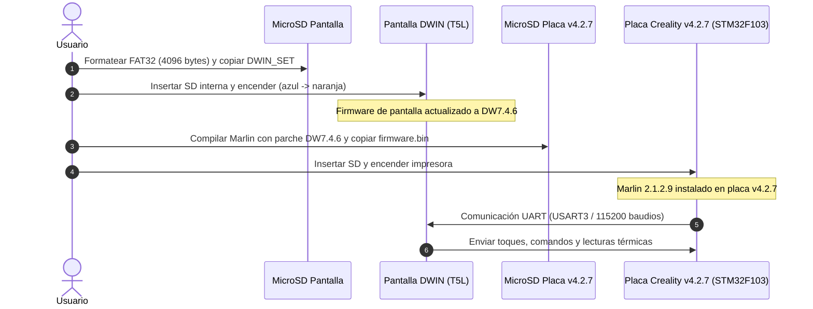

# Subproyecto: Pantalla DWIN DW7.4.6 (Marlin + Creality v4.2.7)

Este subproyecto independiente contiene todo lo necesario para preparar, flashear y comunicar una pantalla táctil **DWIN** con firmware **DW7.4.6** (desarrollado por Insanity Automation / Tiny Machines 3D) junto al firmware **Marlin 2.1.2.9** ejecutándose en una placa **Creality v4.2.7**.

---

## 1. Principio de Aislamiento e Integración

> [!NOTE]
> **Independencia en Desarrollo:**
> - El código fuente y entorno de compilación de Marlin residen en el directorio [`Marlin/`](file:///c:/Enavarrete/Proyectos/Marlin/Marlin) y se configuran mediante [`platformio.ini`](file:///c:/Enavarrete/Proyectos/Marlin/platformio.ini).
> - Este subproyecto reside en [`display_DW7.4.6/`](file:///c:/Enavarrete/Proyectos/Marlin/display_DW7.4.6) y no interfiere con las dependencias ni con el compilador de Marlin.
> 
> **Integración en Ejecución:**
> - Al flashear la pantalla con sus recursos (`DWIN_SET`) y flashear la placa con las directivas de comunicación serial habilitadas, ambos sistemas operan en perfecta sincronía mediante el protocolo serie DGUS / DWIN a 115200 baudios.

---

## 2. Estructura del Subproyecto

```
display_DW7.4.6/
├── README.md                                  # Este documento explicativo
├── DWIN_SET/
│   └── README_DWIN_SET.md                     # Guía de archivos, formato FAT32 y 4096 bytes
├── hardware/
│   └── pinout_creality_v427_dwin.md           # Diagrama de pines (EXP1 a puerto serie DWIN)
└── marlin_integration/
    └── Configuration_DW7.4.6_patch.h          # Parches de código para Configuration.h y Configuration_adv.h
```

---

## 3. Flujo de Trabajo para Ponerlos a Trabajar Juntos



---

## 4. Guías Detalladas

1. **Esquema de Conexión de Pines**:
   Consulta [hardware/pinout_creality_v427_dwin.md](file:///c:/Enavarrete/Proyectos/Marlin/display_DW7.4.6/hardware/pinout_creality_v427_dwin.md) para verificar el conexionado entre el conector EXP1 de la placa 4.2.7 y la pantalla DWIN.
2. **Preparación y Flasheo de la Pantalla**:
   Consulta [DWIN_SET/README_DWIN_SET.md](file:///c:/Enavarrete/Proyectos/Marlin/display_DW7.4.6/DWIN_SET/README_DWIN_SET.md) para el formateo correcto de la tarjeta MicroSD e instalación de los recursos gráficos.
3. **Parches de Marlin**:
   Consulta [marlin_integration/Configuration_DW7.4.6_patch.h](file:///c:/Enavarrete/Proyectos/Marlin/display_DW7.4.6/marlin_integration/Configuration_DW7.4.6_patch.h) con las directivas exactas para que Marlin hable con la pantalla.
